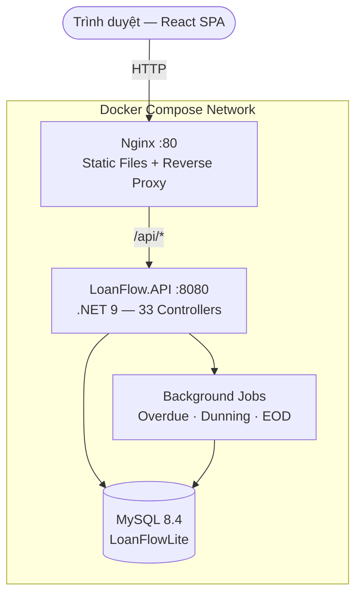

# LoanFlow Lite 💳

> **Hệ thống quản lý vòng đời khoản vay End-to-End** — từ tiếp nhận hồ sơ, thẩm định, giải ngân, thu nợ, xử lý nợ xấu, cho đến đối soát & tất toán.

---

## 📋 Mục lục

- [Tổng quan](#tổng-quan)
- [Tech Stack](#tech-stack)
- [Luồng nghiệp vụ (Business Flow)](#luồng-nghiệp-vụ-business-flow)
  - [Phase 1 — Tiếp nhận khách hàng (Origination)](#phase-1--tiếp-nhận-khách-hàng-origination)
  - [Phase 2 — Thẩm định & Phê duyệt (Underwriting)](#phase-2--thẩm-định--phê-duyệt-underwriting)
  - [Phase 3 — Giải ngân & Quản lý khoản vay (Disbursement)](#phase-3--giải-ngân--quản-lý-khoản-vay-disbursement)
  - [Phase 4 — Thu nợ & Phân bổ dòng tiền (Repayment)](#phase-4--thu-nợ--phân-bổ-dòng-tiền-repayment)
  - [Phase 5 — Quản lý nợ xấu & Thu hồi (Collection)](#phase-5--quản-lý-nợ-xấu--thu-hồi-collection)
  - [Phase 6 — Vòng đời nâng cao (Lifecycle)](#phase-6--vòng-đời-nâng-cao-lifecycle)
  - [Phase 7 — Sổ cái, Đối soát & Báo cáo (Ledger & Reconciliation)](#phase-7--sổ-cái-đối-soát--báo-cáo-ledger--reconciliation)
- [Kiến trúc hệ thống](#kiến-trúc-hệ-thống)
- [Phân quyền (RBAC)](#phân-quyền-rbac)
- [Cài đặt & Chạy](#cài-đặt--chạy)
- [API Endpoints tổng hợp](#api-endpoints-tổng-hợp)

---

## Tổng quan

LoanFlow Lite số hóa toàn bộ vòng đời khoản vay (**Loan Lifecycle**), thay thế quy trình thủ công bằng hệ thống có kiểm soát phê duyệt, truy vết dữ liệu và đối soát tài chính tự động.

**Đối tượng sử dụng:**
- 🏦 Công ty tài chính (SME Lenders)
- 🏬 Chuỗi bán lẻ trả góp (Điện máy, Xe máy)
- 🤝 Quỹ tín dụng vi mô

---

## Tech Stack

| Layer | Công nghệ |
|---|---|
| **Backend** | ASP.NET Core 9, Entity Framework Core 9, MySQL 8.4 |
| **Frontend** | React 18, Vite 5, React Router DOM v6 |
| **Security** | JWT Bearer, BCrypt, Rate Limiting, Idempotency Filter |
| **DevOps** | Docker Compose, Nginx Reverse Proxy |

---

## Luồng nghiệp vụ (Business Flow)

Toàn bộ hệ thống được thiết kế theo **7 Phase** tương ứng với vòng đời thực tế của một khoản vay:

```
┌──────────┐    ┌──────────┐    ┌──────────┐    ┌──────────┐
│ Phase 1  │───▶│ Phase 2  │───▶│ Phase 3  │───▶│ Phase 4  │
│Origination│   │Underwrite│   │Disburse  │    │Repayment │
└──────────┘    └──────────┘    └──────────┘    └────┬─────┘
                                                     │
     ┌──────────┐    ┌──────────┐    ┌──────────┐    │
     │ Phase 7  │◀───│ Phase 6  │◀───│ Phase 5  │◀───┘
     │Reconcile │    │Lifecycle │    │Collection│
     └──────────┘    └──────────┘    └──────────┘
```

---

### Phase 1 — Tiếp nhận khách hàng (Origination)

> **Ai thực hiện:** Loan Officer  
> **Mục tiêu:** Thu thập thông tin khách hàng, đánh giá sơ bộ, tạo hồ sơ vay.

| Bước | Hành động | Service / Entity |
|------|-----------|-----------------|
| 1.1 | Tạo hồ sơ khách hàng (CMND, địa chỉ, SĐT) | `CustomerService` → `Customer` |
| 1.2 | Upload giấy tờ (CMND, hộ khẩu, bảng lương) | `DocumentService` → `CustomerDocument` |
| 1.3 | eKYC — Xác minh danh tính điện tử | `EkycService` → `EkycVerification` |
| 1.4 | Kiểm tra CIC (lịch sử tín dụng quốc gia) | `CicService` → `CicInquiry` |
| 1.5 | Credit Scoring (chấm điểm tín dụng nội bộ) | `CreditCheckService` → `CreditCheck` |
| 1.6 | Kiểm tra giới hạn dư nợ khách hàng (Exposure Limit) | `ExposureLimitService` → `CustomerExposureLimit` |
| 1.7 | Chọn sản phẩm vay, nhập số tiền & kỳ hạn | `LoanApplicationService` → `LoanApplication` |
| 1.8 | Xem trước lịch trả góp dự kiến (Preview) | `LoanApplicationService.PreviewAsync()` |

**Kết quả:** Hồ sơ vay ở trạng thái `Draft`, sẵn sàng nộp lên phê duyệt.

---

### Phase 2 — Thẩm định & Phê duyệt (Underwriting)

> **Ai thực hiện:** Loan Officer (Submit) → Approver (Decide)  
> **Mục tiêu:** Đánh giá rủi ro và ra quyết định cho vay.

| Bước | Hành động | Service / Entity |
|------|-----------|-----------------|
| 2.1 | Officer nộp hồ sơ (`Draft → Submitted`) | `LoanApplicationService.SubmitAsync()` |
| 2.2 | Hệ thống kiểm tra Approval Rules tự động | `ApprovalRuleService` → `ApprovalRule` |
| 2.3 | Đăng ký tài sản đảm bảo (nếu có) | `CollateralService` → `Collateral`, `LoanCollateral` |
| 2.4 | Approver xem hàng đợi phê duyệt | `GET /approvals/queue` |
| 2.5 | Approver ra quyết định: **Approve** hoặc **Reject** | `LoanApplicationService` → `ApplicationDecision` |

**Luồng trạng thái:**
```
Draft ──submit──▶ Submitted ──approve──▶ Approved ──▶ Giải ngân
                              │
                              └──reject──▶ Rejected (Kết thúc)
```

**Maker-Checker:** Mọi thao tác nhạy cảm đều qua cơ chế **2 tầng** — người tạo (Maker) khác người duyệt (Checker). Lưu Audit Log đầy đủ.

---

### Phase 3 — Giải ngân & Quản lý khoản vay (Disbursement)

> **Ai thực hiện:** Loan Officer  
> **Mục tiêu:** Chuyển tiền cho khách hàng, kích hoạt khoản vay.

| Bước | Hành động | Service / Entity |
|------|-----------|-----------------|
| 3.1 | Tạo khoản vay từ hồ sơ đã duyệt | `LoanService.DisburseAsync()` → `Loan` |
| 3.2 | Hệ thống sinh mã khoản vay tự động (`LN-YYYYMMDD-XXXX`) | Auto-generated |
| 3.3 | Ghi nhận giải ngân & tạo bút toán sổ cái | `LoanDisbursement` + `LoanTransaction` |
| 3.4 | Tự động sinh lịch trả nợ (công thức PMT) | `RepaymentSchedule` (N kỳ) |
| 3.5 | Idempotency Filter — chống giải ngân trùng lặp (double-click) | `IdempotencyRecord` |

**Kết quả:** Khoản vay chuyển sang trạng thái `Active`. Khách hàng bắt đầu nghĩa vụ trả nợ.

---

### Phase 4 — Thu nợ & Phân bổ dòng tiền (Repayment)

> **Ai thực hiện:** Collector / Loan Officer  
> **Mục tiêu:** Ghi nhận thanh toán của khách hàng, phân bổ tiền đúng thứ tự ưu tiên.

| Bước | Hành động | Service / Entity |
|------|-----------|-----------------|
| 4.1 | Ghi nhận thanh toán (Cash / Transfer / Auto-Debit) | `LoanService.RecordPaymentAsync()` → `Payment` |
| 4.2 | Hệ thống phân bổ tự động theo Waterfall | `PaymentAllocation` |
| 4.3 | Cập nhật dư nợ còn lại (Outstanding) | `Loan.OutstandingAmount` |
| 4.4 | Phần dư (nếu có) → Tạm giữ (Suspense Account) | `SuspenseTransaction` |
| 4.5 | Tính phí trễ hạn tự động (nếu quá hạn) | `LateFeeService` → `LateFee` |

**Waterfall Allocation (Thứ tự ưu tiên phân bổ tiền):**
```
Tiền khách đóng
    │
    ├─ 1. Phí trễ hạn (Late Fee)      ──▶ Trừ nợ phí
    ├─ 2. Lãi (Interest)              ──▶ Trừ nợ lãi
    ├─ 3. Gốc (Principal)             ──▶ Trừ nợ gốc
    └─ 4. Dư thừa (Overpayment)       ──▶ Suspense Account (kỳ sau)
```

**Idempotency:** Mỗi giao dịch thanh toán có `Idempotency Key` riêng, đảm bảo không bao giờ ghi nhận trùng lặp dù client gửi request nhiều lần.

---

### Phase 5 — Quản lý nợ xấu & Thu hồi (Collection)

> **Ai thực hiện:** Collector, Manager  
> **Mục tiêu:** Theo dõi các khoản vay quá hạn, phân công nhân viên thu hồi, thực hiện hành động nhắc nợ.

| Bước | Hành động | Service / Entity |
|------|-----------|-----------------|
| 5.1 | Overdue Job chạy hàng ngày — phát hiện nợ quá hạn | `OverdueJobService` (Background) |
| 5.2 | Phân loại bucket quá hạn (DPD 1–7, 8–30, 31–60, 61–90, 90+) | `OverdueDailySnapshot`, `ClassificationSnapshot` |
| 5.3 | Phân công Collector cho từng khoản nợ | `CollectionService` → `CollectorAssignment` |
| 5.4 | Collector xem hàng đợi cá nhân (`/collections/queue`) | `CollectionService.GetCollectorQueueAsync()` |
| 5.5 | Ghi nhận hành động thu hồi (gọi điện, gặp trực tiếp, gửi thư) | `CollectionAction` |
| 5.6 | Ghi chú nhắc nợ | `CollectionNote` |
| 5.7 | Dunning tự động — gửi thông báo nhắc nợ theo chiến lược | `DunningService` → `DunningStrategy`, `NotificationTemplate` |

**Dunning Automation:**
```
DPD ≥ 1  ──▶ SMS nhắc nhẹ
DPD ≥ 7  ──▶ Email cảnh báo
DPD ≥ 30 ──▶ Thư yêu cầu thanh toán
DPD ≥ 60 ──▶ Gọi điện / Gặp trực tiếp
DPD ≥ 90 ──▶ Chuyển pháp lý / Xóa nợ
```

---

### Phase 6 — Vòng đời nâng cao (Lifecycle)

> **Ai thực hiện:** Approver, Manager  
> **Mục tiêu:** Xử lý các tình huống đặc biệt trong vòng đời khoản vay.

| Tình huống | Mô tả | Service |
|------------|-------|---------|
| 🔄 **Restructure** | Cơ cấu lại khoản vay (thay đổi lãi suất, kỳ hạn) | `LoanLifecycleService` |
| 📅 **Reschedule** | Dời ngày trả nợ hàng tháng | `LoanLifecycleService` |
| 💰 **Top-Up** | Giải ngân thêm trên khoản vay hiện tại | `LoanTopUpService` |
| ⬆️ **Early Settlement** | Tất toán trước hạn (tính lãi thực tế) | `LoanService.EarlySettleAsync()` |
| ↩️ **Reversal** | Hủy giao dịch sai (Maker request → Checker approve) | `ReversalService` |
| 📝 **Manual Adjustment** | Điều chỉnh lãi/phí thủ công (qua Approval Flow) | `LoanAdjustmentService` |
| ❌ **Write-Off** | Xóa nợ xấu không có khả năng thu hồi | `LoanLifecycleService` |
| 💵 **Recovery** | Thu hồi tiền sau khi đã xóa nợ | `LoanLifecycleService.RecordRecoveryAsync()` |

**Reversal Chain (Chuỗi hủy giao dịch):**
```
Officer yêu cầu hủy ──▶ TransactionReversal (Pending)
                              │
Approver duyệt ──────▶ TransactionReversal (Approved)
                              │
Hệ thống tự động:            ├─ Tạo bản ghi Mirror âm (PaymentAllocation)
                              ├─ Hoàn trả dư nợ (Outstanding)
                              └─ Ghi Audit Log
```
> **Nguyên tắc:** Không bao giờ xóa/sửa dữ liệu gốc. Mọi thay đổi đều được ghi nhận bằng bản ghi bổ sung (Immutable Ledger).

---

### Phase 7 — Sổ cái, Đối soát, Đa tiền tệ & Báo cáo (Ledger, Multi-currency & Reconciliation)

> **Ai thực hiện:** Hệ thống (tự động, cuối ngày) + Manager (xem báo cáo)  
> **Mục tiêu:** Đảm bảo tính toàn vẹn tài chính, đồng bộ liên ngân hàng (Interbank) và xuất báo cáo pháp quy.

| Bước | Hành động | Service |
|------|-----------|---------|
| 7.1 | End-of-Day Job — chạy tự động cuối ngày | `EndOfDayService` |
| 7.2 | Đánh giá lại tỷ giá ngoại tệ (FX Revaluation) | `EndOfDayService.ProcessExchangeRateRevaluationAsync()` |
| 7.3 | Khớp lệnh tài khoản ảo (Virtual Account Matching) | `VirtualAccountMatchingService` |
| 7.4 | Đồng bộ bút toán liên ngân hàng (Core Banking Sync) | `CoreBankingIntegrationService` |
| 7.5 | Đối soát 6 điểm (Reconciliation Engine) | `ReconciliationService` |
| 7.6 | Quản lý kỳ kế toán (Mở / Đóng sổ) | `AccountingPeriodService` |
| 7.7 | Bút toán kế toán (Journal Entry) | `AccountingService` → `JournalEntry`, `JournalEntryLine` |
| 7.8 | Báo cáo NPL (Non-Performing Loan) | `NplReportingService` |
| 7.9 | Báo cáo pháp quy (Regulatory Report) | `RegulatoryReportingService` |

**6 điểm đối soát (Reconciliation Checks):**
```
✓ Payment Check     — Tổng thanh toán = Tổng allocation?
✓ Allocation Check  — Principal + Interest + LateFee + Suspense = Payment Amount?
✓ Disbursement Check— Tổng giải ngân = Tổng gốc ban đầu?
✓ Reversal Check    — Reversal có mirror âm đầy đủ?
✓ LateFee Check     — Phí trễ hạn khớp với ngày quá hạn?
✓ Suspense Check    — Tài khoản tạm giữ đã được giải quyết?
```

---

## Kiến trúc hệ thống



**Clean Architecture — 4 layers:**

| Layer | Vai trò | Số lượng |
|-------|---------|----------|
| `Domain` | Entities, Constants, Enums (không phụ thuộc layer nào) | 50 entities |
| `Application` | Business logic, DTOs, Interfaces | 39 services |
| `Infrastructure` | DbContext, EF Configurations, Seeder | Fluent API configs |
| `API` | Controllers (REST), Middleware, Filters | 33 controllers |

---

## Phân quyền (RBAC)

| Vai trò | Phase 1–2 | Phase 3–4 | Phase 5 | Phase 6–7 |
|---------|-----------|-----------|---------|-----------|
| **Admin** | ✅ Toàn quyền | ✅ Toàn quyền | ✅ Toàn quyền | ✅ Toàn quyền |
| **Manager** | ✅ Xem | ❌ | ✅ Phân công + Xem | ✅ Write-Off, Restructure, Báo cáo |
| **Loan Officer** | ✅ Tạo hồ sơ, Submit | ✅ Giải ngân, Thu nợ | ❌ | ✅ Request Reversal |
| **Approver** | ✅ Approve/Reject | ❌ | ❌ | ✅ Approve Reversal, Restructure |
| **Collector** | ❌ | ✅ Ghi nhận thanh toán | ✅ Nhắc nợ, Ghi chú | ❌ |

---

## Cài đặt & Chạy

### Yêu cầu
- **Docker** & **Docker Compose** (Không cần cài .NET hay Node.js)

### Khởi động toàn hệ thống

```bash
git clone <repo-url>
cd BankLoan

# Build & Start toàn bộ (Frontend + Backend + MySQL)
docker compose --profile full up -d --build
```

### Truy cập

| Dịch vụ | URL |
|---------|-----|
| 🌐 Web App | `http://localhost` |
| 📡 Swagger API | `http://localhost:8080/swagger` |
| 🗄️ MySQL | `localhost:3306` (root / `LoanFlow@2026!`) |

### Tài khoản mặc định

Hệ thống tự động seed dữ liệu demo khi khởi động lần đầu. Password được random và in ra log container `loanflow-api`.

Đặt trước password qua biến môi trường:
```bash
export SEED_ADMIN_PASSWORD=LoanFlow@2026!
export SEED_OFFICER_PASSWORD=LoanFlow@2026!
```

### Chế độ phát triển (Chỉ chạy Database)

```bash
# Chạy MySQL trong Docker, còn API & Frontend chạy trên máy host
docker compose up db -d

# Terminal 1: Backend
cd src/LoanFlow.API && dotnet watch run

# Terminal 2: Frontend
cd frontend && npm run dev
```

---

## API Endpoints tổng hợp

### 🔐 Auth & Security
| Method | Endpoint | Mô tả |
|--------|----------|-------|
| `POST` | `/api/auth/login` | Đăng nhập, nhận JWT |
| `POST` | `/api/auth/refresh` | Gia hạn token (HttpOnly Cookie) |
| `POST` | `/api/auth/logout` | Đăng xuất |
| `GET` | `/api/auth/sessions` | Xem phiên đăng nhập |

### 👤 Customers (Phase 1)
| Method | Endpoint | Mô tả |
|--------|----------|-------|
| `GET/POST` | `/api/customers` | Danh sách / Tạo khách hàng |
| `GET/PUT` | `/api/customers/{id}` | Chi tiết / Cập nhật |
| `POST` | `/api/ekyc/verify` | Xác minh eKYC |
| `POST` | `/api/cic/inquire` | Tra cứu CIC |

### 📝 Applications (Phase 2)
| Method | Endpoint | Mô tả |
|--------|----------|-------|
| `GET/POST` | `/api/applications` | Danh sách / Tạo hồ sơ vay |
| `POST` | `/api/applications/{id}/submit` | Nộp hồ sơ |
| `POST` | `/api/applications/{id}/approve` | Phê duyệt |
| `POST` | `/api/applications/{id}/reject` | Từ chối |
| `POST` | `/api/applications/preview` | Xem trước lịch trả góp |

### 💰 Loans (Phase 3–4)
| Method | Endpoint | Mô tả |
|--------|----------|-------|
| `GET` | `/api/loans` | Danh sách khoản vay |
| `POST` | `/api/loans/disburse` | Giải ngân |
| `POST` | `/api/loans/{id}/payments` | Ghi nhận thanh toán |
| `GET` | `/api/loans/{id}/schedule` | Xem lịch trả nợ |
| `POST` | `/api/loans/{id}/early-settle` | Tất toán trước hạn |

### 📞 Collections (Phase 5)
| Method | Endpoint | Mô tả |
|--------|----------|-------|
| `GET` | `/api/collections/queue` | Hàng đợi thu hồi nợ |
| `POST` | `/api/loans/{id}/assign-collector` | Phân công Collector |
| `POST` | `/api/loans/{id}/collection-actions` | Ghi nhận hành động thu hồi |
| `POST` | `/api/dunning/execute` | Chạy nhắc nợ tự động |

### 🔄 Lifecycle (Phase 6)
| Method | Endpoint | Mô tả |
|--------|----------|-------|
| `POST` | `/api/loans/{id}/restructure` | Cơ cấu lại khoản vay |
| `POST` | `/api/loans/{id}/reschedule` | Dời lịch trả nợ |
| `POST` | `/api/loans/{id}/request-reversal` | Yêu cầu hủy giao dịch |
| `POST` | `/api/reversals/{id}/approve` | Duyệt hủy giao dịch |
| `POST` | `/api/loans/{id}/write-off` | Xóa nợ |
| `POST` | `/api/loans/{id}/recovery` | Thu hồi sau xóa nợ |

### 📊 Reports, Ledger & Interbank (Phase 7)
| Method | Endpoint | Mô tả |
|--------|----------|-------|
| `GET` | `/api/dashboard/summary` | Tổng quan portfolio |
| `POST` | `/api/reconciliation/run` | Chạy đối soát |
| `GET` | `/api/reports/npl` | Báo cáo nợ xấu |
| `GET` | `/api/reports/regulatory` | Báo cáo pháp quy |
| `GET` | `/api/data-export/{type}` | Xuất dữ liệu |
| `POST` | `/api/interbank/sync-journals` | Push bút toán lên Core Banking |
| `POST` | `/api/interbank/virtual-account-webhook` | Webhook nhận thanh toán từ VA |

---

## 📄 License

Dự án được phát triển cho mục đích demo và thương mại hóa nội bộ.

---

*Built with ❤️ using ASP.NET Core 9 · React · MySQL · Docker*
