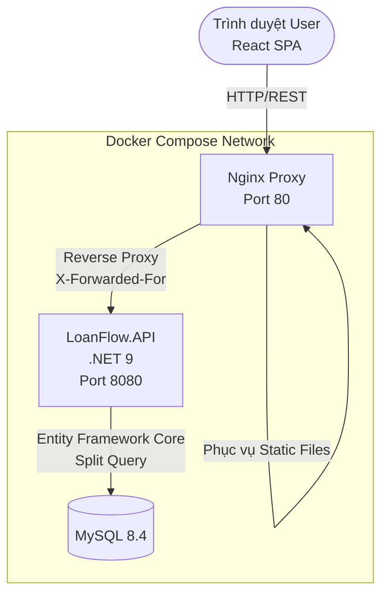

# LoanFlow Lite 💳

> **Hệ thống quản lý vòng đời khoản vay toàn diện & Hệ thống Sổ cái (Ledger) cấp độ Production** — Giải pháp công nghệ đáng tin cậy dành cho công ty tài chính, tổ chức tín dụng vi mô, đại lý trả góp.

LoanFlow Lite là một kiến trúc quản trị khoản vay khép kín (End-to-End Loan Management System), số hóa hoàn toàn các quy trình từ lúc nộp hồ sơ, thẩm định, giải ngân cho tới khi tất toán. Đặc biệt, hệ thống tối ưu hóa tính **minh bạch và toàn vẹn dữ liệu** thông qua cơ chế sổ cái kép (Ledger Chain), phân bổ thanh toán Waterfall và Engine đối soát tự động (Reconciliation).

---

## 📋 Mục lục

- [Tổng quan](#tổng-quan)
- [Tính năng nổi bật (Production-Ready)](#tính-năng-nổi-bật-production-ready)
- [Kiến trúc hệ thống](#kiến-trúc-hệ-thống)
- [Tech Stack](#tech-stack)
- [Cấu trúc dự án](#cấu-trúc-dự-án)
- [Cài đặt & Chạy (Docker Compose)](#cài-đặt--chạy-docker-compose)
- [Phân quyền (RBAC)](#phân-quyền-rbac)
- [Luồng nghiệp vụ cốt lõi](#luồng-nghiệp-vụ-cốt-lõi)
- [Roadmap & Tình trạng](#roadmap--tình-trạng)

---

## Tổng quan

LoanFlow Lite thay thế các bảng tính thủ công rời rạc bằng một hệ thống đáng tin cậy với khả năng truy vết dữ liệu (auditability) chuẩn mực. 

**Đối tượng sử dụng lý tưởng:**
- 🏦 Tổ chức/Công ty tài chính (SME Lenders)
- 🏬 Cửa hàng/Chuỗi bán lẻ trả góp (Điện máy, Xe máy)
- 🤝 Các quỹ tín dụng vi mô

---

## Tính năng nổi bật (Production-Ready)

| Module | Chức năng (Features) |
|---|---|
| 🔐 **Security & RBAC** | Đăng nhập JWT, kiểm soát quyền truy cập theo vai trò (Admin, Loan Officer, Approver, Collector). Nhận diện IP thực qua Proxy để Rate Limiting (chống SPAM 429). |
| 🛡️ **Ledger Integrity** | **MỚI!** Chuỗi ghi nhận sổ cái (Ledger Chain) truy vết hoàn toàn đường đi của dòng tiền. Khép kín luồng Reversal (Hủy giao dịch) bằng bản ghi Mirror âm, đảm bảo không bao giờ sửa/xóa dữ liệu gốc (Immutability). |
| ⚖️ **Reconciliation Engine** | **MỚI!** Chạy đối soát cuối ngày (EOD) với 6 điểm kiểm tra chéo (Payments, Disbursements, Suspense, LateFees, Reversals, Allocations). Mang lại 100% tự tin về dữ liệu tài chính. |
| 💸 **Payment Allocation** | Lược đồ Waterfall tự động: Tiền khách hàng đóng sẽ ưu tiên cấn trừ Phí Trễ Hạn → Lãi → Gốc. Phần dư (nếu có) được đẩy vào tài khoản tạm giữ (Suspense Account) cho kỳ sau. |
| 📦 **Sản phẩm Vay** | Tham số hóa hạn mức, kỳ hạn, lãi suất, phí xử lý. |
| ✅ **Quy trình Phê duyệt** | Maker-Checker chuẩn (Submit → Under Review → Approve/Reject). Lưu trữ Audit Log cho mọi thay đổi. |
| 📅 **Lịch Trả Nợ (PMT)** | Tự động sinh lịch trả nợ chuẩn tài chính, phân tách rạch ròi Gốc dự kiến, Lãi dự kiến theo từng chu kỳ. |

---

## Kiến trúc hệ thống



**Nguyên lý Kiến trúc (Clean Architecture):**
- **Domain**: Định nghĩa 14 Entities nghiệp vụ, Constants (chuẩn mực độc lập với framework).
- **Application**: Chứa Logic xử lý (PaymentAllocationService, ReconciliationService), DTOs linh hoạt.
- **Infrastructure**: Giao tiếp Database, định cấu hình DB (EF Fluent API), Seeder chạy lần đầu.
- **API**: Controllers (Endpoints RESTful), Global Exception Filter, Rate Limit, CORS.

---

## Tech Stack

Hệ thống đã trải qua quá trình hiện đại hóa và đóng gói hoàn chỉnh bằng Docker:

### Backend
- **Framework**: ASP.NET Core 9 (Web API)
- **ORM**: Entity Framework Core 9 (Tối ưu hóa bằng Split Query tránh Cartesian explosion)
- **Database**: MySQL 8.4 (thay cho SQL Server trong các bản cũ)
- **Authentication**: JWT Bearer Tokens
- **Bảo mật**: BCrypt.Net-Next (Hashed Passwords), Global Rate Limiting, Idempotency Keys (ngăn Double-Click giải ngân/thanh toán)

### Frontend
- **Framework**: React 18, React Router DOM v6
- **Build Tool**: Vite 5
- **Giao diện**: HTML/CSS thuần túy tối ưu hóa UX (Single Page Application nhanh và nhẹ nhàng).

### DevOps & Deployment
- Docker & Docker Compose đa dịch vụ
- Nginx đóng vai trò Web Server (SPA) và API Proxy
- Config linh hoạt qua Profile (`docker compose --profile full`)

---

## Cấu trúc dự án

```text
BankLoan/
├── docker-compose.yml                 # Orchestration cho Prod/Dev
├── docker-compose.override.yml        # Config map ports nội bộ
├── frontend/                          # Client-side React/Vite app
│   ├── index.html
│   ├── package.json
│   ├── vite.config.js
│   └── src/                           # JSX Components, Hooks, API utils
└── src/                               # Server-side .NET 9 API
    ├── LoanFlow.Domain/               # Lõi nghiệp vụ (Entities)
    ├── LoanFlow.Application/          # Logic xử lý chính (Services)
    ├── LoanFlow.Infrastructure/       # Database Context, EF Configs
    └── LoanFlow.API/                  # REST Controllers & Middleware
```

---

## Cài đặt & Chạy (Docker Compose)

### Yêu cầu tiên quyết
- **Docker** và **Docker Compose**

### Khởi động toàn hệ thống với 1 câu lệnh

Không cần cài đặt .NET SDK hay Node.js trên máy! Bạn chỉ cần Clone dự án và sử dụng cấu hình Docker Compose đã được chuẩn bị sẵn:

```bash
git clone <repo-url>
cd BankLoan

# Chạy lệnh sau để build và start toàn bộ hệ thống (Frontend + Backend + MySQL)
docker compose --profile full up -d --build
```

### Cách truy cập
- **Web App (Frontend)**: `http://localhost`
- **Backend API (Swagger)**: `http://localhost:8080/swagger`
- **Database (MySQL)**: `localhost:3306` (Tài khoản: `root` / `LoanFlow@2026!`)

> **Lưu ý**: Lần đầu tiên khởi chạy, Database sẽ tự động chèn (seed) hệ thống dữ liệu mẫu bao gồm Danh mục GL, Chi nhánh, Quy tắc mượn tiền và các user. Password cho các user (`admin`, `officer01`, `approver01`...) sẽ được random và in ra trong log của container `loanflow-api`. 
>
> *(Bạn cũng có thể chạy Script tạo mật khẩu tĩnh `LoanFlow@2026!` nếu cần thiết trong quá trình UAT).*

---

## Phân quyền (RBAC)

Không phải ai cũng có thể phê duyệt hay thu tiền. Hệ thống quy định rõ:

| Vai trò | Quyền |
|---|---|
| **Admin** | Toàn quyền kiểm soát, quản lý user, chi nhánh, sản phẩm, dashboard chiến lược. |
| **Loan Officer** | Chuyên viên tín dụng. Tạo hồ sơ, nộp hồ sơ xin duyệt, giải ngân. |
| **Approver** | Thẩm định viên. Chịu trách nhiệm Approve (Duyệt) hoặc Reject (Từ chối). |
| **Collector** | Nhân viên thu hồi nợ. Nhập liệu thu tiền, xem danh sách nợ quá hạn, ghi chú nhắc nợ. |

---

## Luồng nghiệp vụ cốt lõi

1. **Khởi tạo**: [Officer] Tiếp nhận thông tin > Tạo Khách hàng > Tạo Hồ sơ vay (Application).
2. **Thẩm định**: [Officer] Submit hồ sơ > [Approver] Review & Phê duyệt (Approve).
3. **Giải ngân**: [Officer] Thực hiện giải ngân > Hệ thống tạo Mã Khoản Vay > Sinh lịch trả nợ (Schedule) & Ghi Audit.
4. **Thu nợ**: [Collector] Ghi nhận giao dịch > Hệ thống tự động phân bổ tiền (Trễ hạn -> Lãi -> Gốc) > Tính toán số dư còn lại (Outstanding).
5. **Ghi sổ & Đối soát**: Hệ thống móc nối tự động vào Sổ cái. Cuối ngày chạy Reconcile Job kiểm tra tính đúng đắn của dòng tiền.

---

## Roadmap & Tình trạng

### ✅ Đã hoàn thành (v2.0 - Production Ready)
- [x] Chuyển đổi công nghệ lên .NET 9 & React/Vite
- [x] Triển khai toàn bộ qua Docker Compose
- [x] Waterfall Payment Allocation & Suspense Accounts
- [x] Kế toán sổ cái chuỗi khép kín (Ledger Chain) cho Payment, Reversal, Disbursement
- [x] Engine Đối soát dữ liệu tài chính tự động (Reconciliation Engine - Confidence ~92%)
- [x] Cơ chế chống gian lận/lặp giao dịch (Idempotency Filter)
- [x] Chống DDoS & Local Spamming thông qua Rate Limiting (Trust Proxies X-Forwarded-For)
- [x] Split Query tối ưu hóa truy vấn EF Core n+1

*Dự án đã sẵn sàng cho môi trường Production (Go-Live).*

---

*Built with ❤️ & Focus on Integrity using ASP.NET Core 9, EF Core, React & Docker.*
