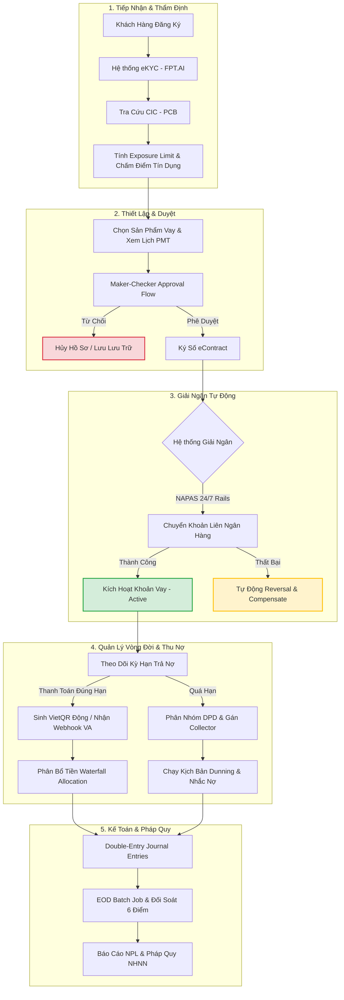

# LoanFlow Enterprise 💳

> **Enterprise-Grade Loan Lifecycle Management & Payment Orchestration Platform**  
> Giải pháp số hóa toàn diện quy trình cấp tín dụng, tự động hóa giải ngân liên ngân hàng 24/7, tối ưu hóa thu hồi nợ và đảm bảo tính toàn vẹn tài chính cho các Tổ chức Tài chính, Công ty Tài chính (Fintech) và Quỹ Tín dụng.

---

## 📈 Kiến tạo Giá trị Doanh nghiệp (Business Value Proposition)

Trong kỷ nguyên số, tốc độ xử lý hồ sơ và khả năng quản trị rủi ro là yếu tố sống còn của các tổ chức tín dụng. **LoanFlow Enterprise** giải quyết triệt để các rào cản vận hành truyền thống bằng cách chuyển đổi quy trình thủ công phức tạp thành một chuỗi vận hành số hóa, tự động và bảo mật tuyệt đối.

```
┌────────────────────────────────────────────────────────────────────────┐
│                        LOANFLOW PLATFORM VALUE                         │
├───────────────────┬───────────────────┬────────────────────────────────┤
│   Tăng Trưởng     │   Giảm Chi Phí    │       Kiểm Soát Rủi Ro        │
│   (Revenue Up)    │  (Cost Reduction) │        (Risk Mitigation)       │
├───────────────────┼───────────────────┼────────────────────────────────┤
│ • Giải ngân 24/7  │ • Tự động hóa 90% │ • eKYC & CIC thời gian thực    │
│ • Rút ngắn TAT    │ • Giảm nhân sự    │ • Rule Engine chấm điểm tự động│
│   (Turnaround Time)│   đối soát thủ công│ • Cảnh báo sớm nợ xấu (NPL)   │
└───────────────────┴───────────────────┴────────────────────────────────┘
```

---

## 🚀 4 Trụ Cột Vận Hành Cốt Lõi

### 1. 🛡️ Thẩm Định & Thiết Lập Hạn Mức Thông Minh (Smart Underwriting)
* **eKYC Tích Hợp**: Tự động nhận diện khuôn mặt (Face Match) và trích xuất thông tin giấy tờ (OCR CMND/CCCD) thông qua cổng FPT.AI, giảm thiểu gian lận danh tính.
* **Tra cứu CIC Quốc Gia**: Kết nối thời gian thực với trung tâm thông tin tín dụng quốc gia (PCB/CIC) để tự động thẩm định lịch sử nợ xấu của khách hàng.
* **Internal Credit Scoring**: Hệ thống tự động chấm điểm tín dụng dựa trên thuật toán tích hợp, phân loại rủi ro khách hàng từ nhóm A đến E.
* **Exposure Limit**: Quản lý hạn mức dư nợ tối đa trên từng khách hàng, ngăn chặn rủi ro tập trung dòng vốn.

### 2. ⚡ Giải Ngân Tự Động & Thanh Toán Tức Thời (Payment Orchestration)
* **NAPAS 24/7 Integration**: Hỗ trợ chuyển khoản liên ngân hàng tức thì ngay sau khi phê duyệt hồ sơ vay, bất kể ngày nghỉ hay lễ tết.
* **Cơ chế Bảo vệ Giao dịch (Polly Resiliency & Idempotency)**: Chống giải ngân trùng lặp (Idempotent request) và tự động thử lại 3 lần với exponential backoff đối với các lỗi mạng tạm thời.
* **Compensating Action**: Tự động kích hoạt luồng Reversal (Hủy giao dịch) khi xác định giao dịch giải ngân thất bại hoàn toàn từ phía NAPAS, đảm bảo cân bằng sổ sách ngay lập tức.
* **Mã QR Động VietQR**: Tự động sinh mã VietQR chuẩn EMV QRCPS offline đi kèm số tiền cần đóng theo từng kỳ hạn, giúp khách hàng thanh toán nhanh chóng chỉ qua một thao tác quét camera điện thoại.

### 3. 🎯 Quản Lý Thu Nợ Chủ Động (Intelligent Collections & Dunning)
* **Waterfall Allocation**: Cơ chế phân bổ dòng tiền thanh toán nghiêm ngặt theo chuẩn tài chính quốc tế: *Phí trễ hạn → Lãi quá hạn → Lãi trong hạn → Gốc → Tài khoản tạm giữ (Suspense Account)*.
* **Phân Loại Nợ Tự Động (DPD - Days Past Due)**: Phân nhóm nợ tự động theo thời gian quá hạn (DPD 1–7, 8–30, 31+) và cập nhật nhóm nợ 1–5 theo quy định của Ngân hàng Nhà nước (NHNN).
* **Định Tuyến & Phân Công Collector**: Tự động phân phối danh sách nợ quá hạn cho nhân viên thu hồi nợ (Collector) dựa trên quy tắc tối ưu hóa nguồn lực.
* **Dunning Strategy**: Thiết lập kịch bản nhắc nợ đa kênh tự động (SMS OTP, Email, ghi chép lịch sử tương tác cuộc gọi).

### 4. 🏦 Toàn Vẹn Tài Chính & Kiểm Toán Sổ Cái (Immutable Ledger & Reconciliation)
* **Immutable Double-Entry Ledger**: Hệ thống sổ cái kế toán kép không thể sửa xóa (Append-only), đảm bảo tính toàn vẹn dữ liệu và sẵn sàng cho kiểm toán độc lập.
* **Reconciliation Engine 6 Điểm**: Công cụ đối soát tự động đối chiếu dữ liệu giữa *Hồ sơ vay, Lịch trả nợ, Giải ngân thực tế, Thanh toán thực tế, Giao dịch hoàn trả (Reversal) và Sổ cái kế toán*.
* **Auto-Matching Đối Soát NAPAS**: Tự động tải, phân tích và khớp file đối soát từ cổng thanh toán NAPAS hàng ngày, phát hiện và phân loại các giao dịch chênh lệch (Exceptions) để kế toán viên xử lý.
* **End-of-Day (EOD) Batch Job**: Quy trình chạy khóa sổ cuối ngày tự động xử lý trích lập dự phòng, tính lãi cộng dồn hàng ngày (Accruals) và revaluation tỷ giá.

---

## 🔄 Luồng Nghiệp Vụ End-to-End (Business Workflow)



---

## 👥 Phân Vai Trực Quan (User Personas & Access Control)

Hệ thống tuân thủ nghiêm ngặt nguyên tắc bảo mật và phân chia nhiệm vụ nhằm triệt tiêu rủi ro tác nghiệp nội bộ (Maker-Checker):

| Persona / Vai Trò | Trách Nhiệm Nghiệp Vụ | Chức Năng Chính Trên Hệ Thống |
| :--- | :--- | :--- |
| **Loan Officer** <br>*(Nhân Viên Tín Dụng)* | Tiếp xúc khách hàng, khởi tạo và đề xuất phương án vay. | Khởi tạo hồ sơ, thực hiện eKYC/CIC, giải ngân khoản vay đã duyệt, tạo VietQR thu nợ. |
| **Approver** <br>*(Người Phê Duyệt)* | Đánh giá độc lập phương án, kiểm soát rủi ro trước khi ra quyết định. | Duyệt/Từ chối hồ sơ vay, duyệt giao dịch Reversal (Hủy bút toán lỗi), duyệt Restructure. |
| **Manager** <br>*(Quản Lý Chi Nhánh / Risk Director)* | Giám sát danh mục đầu tư tín dụng, điều phối nguồn nhân lực thu hồi nợ. | Điều phối danh sách nợ quá hạn cho Collector, duyệt Write-off nợ xấu, xem báo cáo tổng thể. |
| **Collector** <br>*(Nhân Viên Thu Nợ)* | Tương tác trực tiếp với khách hàng nợ quá hạn để thu hồi dòng tiền. | Xem hàng đợi nợ quá hạn được gán, ghi chép nhật ký hành động thu nợ (Call/SMS/Visit), nhận thanh toán. |
| **Admin** <br>*(Quản Trị Hệ Thống)* | Bảo trì hạ tầng, quản lý cấu hình hệ thống, phân quyền chặt chẽ. | Quản lý người dùng, cấu hình sản phẩm vay, theo dõi log kiểm toán (Audit Trail), vận hành EOD. |

---

## 🛠️ Công Nghệ Phát Triển (Enterprise Tech Stack)

Hệ thống được phát triển trên kiến trúc Clean Architecture ba lớp vững chắc nhằm đáp ứng tải cao và bảo mật ngân hàng:

* **Backend**: `.NET 8 Web API` sử dụng Clean Architecture nguyên bản, tích hợp Entity Framework Core 8, lưu trữ cơ sở dữ liệu trên `MySQL 8.4` tối ưu hóa transaction cô lập cao.
* **Frontend**: Single Page Application (SPA) viết bằng `React 18`, bundler `Vite 5`, quản lý định tuyến với `React Router v6`, và SignalR để cập nhật các thông báo đẩy thời gian thực từ máy chủ.
* **Security & Compliance**: Quản lý phiên qua JWT Bearer tự động làm mới, băm mật khẩu `BCrypt`, ký chữ ký điện tử `HMAC-SHA256` trên payload webhook, và cơ chế ghi log lịch sử tương tác (Audit Trail).
* **Observability**: Thu thập dữ liệu giám sát hiệu năng thông qua `OpenTelemetry`, `Prometheus`, `Grafana`, ghi log cấu trúc `Serilog`.
* **Hạ Tầng**: Container hóa qua `Docker Compose`, cân bằng tải và bảo mật bằng `Nginx Reverse Proxy`.

---

## ⚙️ Hướng Dẫn Cài Đặt Nhanh (Developer Quick Start)

### Yêu Cầu Hạ Tầng
* Đã cài đặt **Docker** & **Docker Compose** trên máy chủ hoặc máy phát triển cá nhân.

### Khởi Chạy Toàn Hệ Thống (Frontend + Backend + Database)

1. Sao chép mã nguồn về máy cục bộ:
   ```bash
   git clone <repo-url>
   cd BankLoan
   ```

2. Cấu hình biến môi trường mẫu:
   ```bash
   cp .env.example .env
   ```

3. Khởi chạy tất cả các dịch vụ bằng một lệnh duy nhất:
   ```bash
   docker compose --profile full up -d --build
   ```

### Địa Chỉ Truy Cập Dịch Vụ

* 🌐 **Cổng Giao Diện Web (React App)**: [http://localhost](http://localhost)
* 📡 **Tài Liệu API Tích Hợp (Swagger UI)**: [http://localhost:8080/swagger](http://localhost:8080/swagger)
* 🗄️ **Cơ Sở Dữ Liệu MySQL**: `localhost:3306` (Thông tin đăng nhập mặc định: root / `LoanFlow@2026!`)

### Tài Khoản Kiểm Thử Mặc Định

| Người Dùng | Vai Trò | Mật Khẩu Khởi Tạo |
| :--- | :--- | :--- |
| `admin` | Admin | `LoanFlow@2026!` |
| `manager` | Manager | `LoanFlow@2026!` |
| `officer` | Loan Officer | `LoanFlow@2026!` |
| `approver` | Approver | `LoanFlow@2026!` |
| `collector` | Collector | `LoanFlow@2026!` |

---

*Hệ thống được phát triển chuyên biệt và tối ưu hóa cho nghiệp vụ tín dụng tiêu dùng và trả góp tại thị trường Việt Nam.*  
**Built with ❤️ using ASP.NET Core 8 · React 18 · MySQL · Docker · NAPAS**
